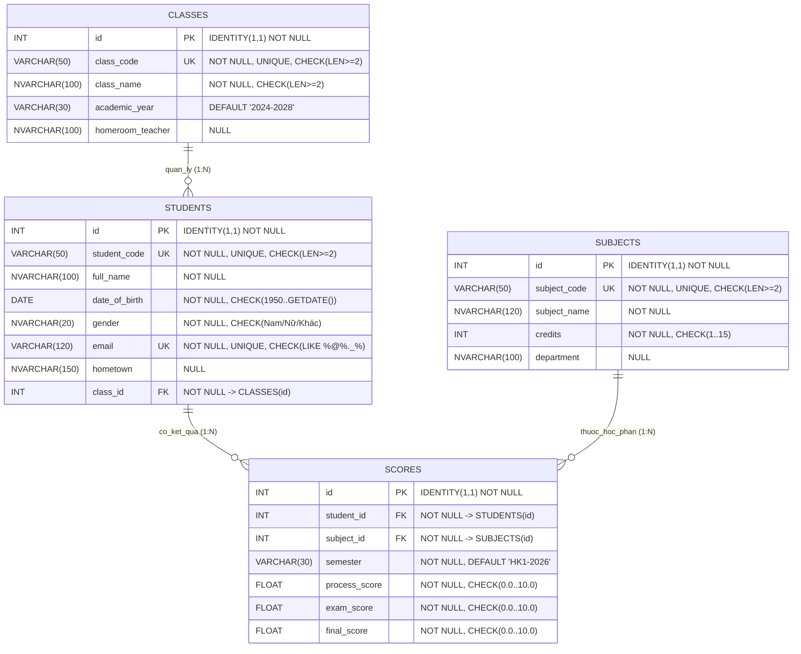

# 🗄️ TÀI LIỆU THIẾT KẾ CƠ SỞ DỮ LIỆU, CHUẨN HÓA 3NF, LẬP TRÌNH T-SQL & HƯỚNG DẪN SSMS 22

**Đề tài:** Hệ thống Quản lý Sinh viên và Điểm thi (`StudentGradeManagementDB`)  
**Hệ quản trị CSDL:** Microsoft SQL Server (SQL Server Management Studio 22 - SSMS 22)  
**Tích hợp Backend:** FastAPI (`main.py`) + Pydantic + SQLAlchemy + `pyodbc`

---

## 1. THIẾT KẾ CƠ SỞ DỮ LIỆU (ERD, LƯỢC ĐỒ QUAN HỆ & CHUẨN HÓA 3NF)

### 1.1. Sơ đồ Thực thể Kết hợp (ERD - Entity Relationship Diagram)

Mối quan hệ nghiệp vụ giữa các thực thể:
- **Lớp học (`classes`) — Sinh viên (`students`):** Quan hệ **1 : N** (Một lớp học có nhiều sinh viên; mỗi sinh viên thuộc duy nhất một lớp học quản lý hành chính).
- **Sinh viên (`students`) — Môn học (`subjects`):** Quan hệ **N : M** được phân rã thành hai quan hệ **1 : N** thông qua thực thể kết hợp **Điểm thi (`scores`)**. Mỗi bản ghi điểm thi đại diện cho kết quả học tập của 1 sinh viên đối với 1 môn học tại 1 học kỳ xác định.



---

### 1.2. Đặc tả Thực thể, Thuộc tính và Ràng buộc

#### Bảng 1: `dbo.classes` (Lớp học)
| Tên cột | Kiểu dữ liệu | Ràng buộc (Constraints) | Ý nghĩa |
| :--- | :--- | :--- | :--- |
| `id` | `INT IDENTITY(1,1)` | `PRIMARY KEY (PK_classes)` | Khóa chính tự tăng |
| `class_code` | `VARCHAR(50)` | `NOT NULL`, `UNIQUE`, `CHECK (LEN >= 2)` | Mã lớp học (VD: `CNTT01-K18`) |
| `class_name` | `NVARCHAR(100)` | `NOT NULL`, `CHECK (LEN >= 2)` | Tên lớp học |
| `academic_year` | `VARCHAR(30)` | `DEFAULT ('2024-2028')` | Niên khóa đào tạo |
| `homeroom_teacher` | `NVARCHAR(100)` | `NULL` | Giảng viên cố vấn / chủ nhiệm |

#### Bảng 2: `dbo.students` (Sinh viên)
| Tên cột | Kiểu dữ liệu | Ràng buộc (Constraints) | Ý nghĩa |
| :--- | :--- | :--- | :--- |
| `id` | `INT IDENTITY(1,1)` | `PRIMARY KEY (PK_students)` | Khóa chính tự tăng |
| `student_code` | `VARCHAR(50)` | `NOT NULL`, `UNIQUE`, `CHECK (LEN >= 2)` | Mã sinh viên (VD: `SV2024001`) |
| `full_name` | `NVARCHAR(100)` | `NOT NULL` | Họ và tên sinh viên |
| `date_of_birth` | `DATE` | `NOT NULL`, `CHECK (1950-01-01 .. GETDATE())` | Ngày sinh |
| `gender` | `NVARCHAR(20)` | `NOT NULL`, `CHECK (gender IN (N'Nam', N'Nữ', N'Khác'))` | Giới tính |
| `email` | `VARCHAR(120)` | `NOT NULL`, `UNIQUE`, `CHECK (LIKE '%_@_%._%')` | Địa chỉ Email sinh viên |
| `hometown` | `NVARCHAR(150)` | `NULL` | Quê quán / Địa chỉ |
| `class_id` | `INT` | `NOT NULL`, `FOREIGN KEY -> dbo.classes(id)` | Khóa ngoại tham chiếu lớp học |

#### Bảng 3: `dbo.subjects` (Môn học)
| Tên cột | Kiểu dữ liệu | Ràng buộc (Constraints) | Ý nghĩa |
| :--- | :--- | :--- | :--- |
| `id` | `INT IDENTITY(1,1)` | `PRIMARY KEY (PK_subjects)` | Khóa chính tự tăng |
| `subject_code` | `VARCHAR(50)` | `NOT NULL`, `UNIQUE`, `CHECK (LEN >= 2)` | Mã học phần (VD: `IT3010`) |
| `subject_name` | `NVARCHAR(120)` | `NOT NULL` | Tên môn học |
| `credits` | `INT` | `NOT NULL`, `CHECK (credits BETWEEN 1 AND 15)` | Số tín chỉ (1 – 15) |
| `department` | `NVARCHAR(100)` | `NULL` | Khoa / Bộ môn phụ trách |

#### Bảng 4: `dbo.scores` (Điểm thi)
| Tên cột | Kiểu dữ liệu | Ràng buộc (Constraints) | Ý nghĩa |
| :--- | :--- | :--- | :--- |
| `id` | `INT IDENTITY(1,1)` | `PRIMARY KEY (PK_scores)` | Khóa chính tự tăng |
| `student_id` | `INT` | `NOT NULL`, `FOREIGN KEY -> dbo.students(id)` | Khóa ngoại tham chiếu sinh viên |
| `subject_id` | `INT` | `NOT NULL`, `FOREIGN KEY -> dbo.subjects(id)` | Khóa ngoại tham chiếu môn học |
| `semester` | `VARCHAR(30)` | `NOT NULL`, `DEFAULT ('HK1-2026')` | Học kỳ (kết hợp UNIQUE bộ 3) |
| `process_score` | `FLOAT` | `NOT NULL`, `CHECK (0.0 <= process_score <= 10.0)` | Điểm quá trình (trọng số 40%) |
| `exam_score` | `FLOAT` | `NOT NULL`, `CHECK (0.0 <= exam_score <= 10.0)` | Điểm thi (trọng số 60%) |
| `final_score` | `FLOAT` | `NOT NULL`, `CHECK (0.0 <= final_score <= 10.0)` | Điểm tổng kết (đồng bộ qua Trigger & API) |

*Ràng buộc duy nhất tổ hợp (Composite Unique Constraint):* `uq_student_subject_semester UNIQUE (student_id, subject_id, semester)`.

---

### 1.3. Chuyển đổi ERD sang Lược đồ Quan hệ (Relational Schema)

- $\text{CLASSES}(\underline{\text{id}}, \text{class\_code}, \text{class\_name}, \text{academic\_year}, \text{homeroom\_teacher})$
- $\text{STUDENTS}(\underline{\text{id}}, \text{student\_code}, \text{full\_name}, \text{date\_of\_birth}, \text{gender}, \text{email}, \text{hometown}, \text{class\_id}_{\text{FK} \to \text{CLASSES.id}})$
- $\text{SUBJECTS}(\underline{\text{id}}, \text{subject\_code}, \text{subject\_name}, \text{credits}, \text{department})$
- $\text{SCORES}(\underline{\text{id}}, \text{student\_id}_{\text{FK} \to \text{STUDENTS.id}}, \text{subject\_id}_{\text{FK} \to \text{SUBJECTS.id}}, \text{semester}, \text{process\_score}, \text{exam\_score}, \text{final\_score})$

---

### 1.4. Chứng minh Chuẩn hóa Dữ liệu đạt Chuẩn 3NF

1. **Đạt Chuẩn 1NF (First Normal Form):**
   - Tất cả các thuộc tính trong cả 4 quan hệ (`classes`, `students`, `subjects`, `scores`) đều mang giá trị nguyên tố (atomic), không có thuộc tính đa trị (multi-valued) hay thuộc tính lặp.
   - Mỗi bảng đều có khóa chính (`id`) xác định duy nhất từng bộ (tuple).

2. **Đạt Chuẩn 2NF (Second Normal Form):**
   - Các bảng `classes`, `students`, `subjects` có khóa chính đơn (`id`) và khóa ứng viên đơn (`class_code`, `student_code`, `email`, `subject_code`), do đó mọi thuộc tính không khóa đều phụ thuộc hàm đầy đủ vào khóa, không tồn tại phụ thuộc bộ phận (partial dependency).
   - Trong bảng `scores`, khóa chính là `id` và khóa ứng viên nghiệp vụ là bộ ba `(student_id, subject_id, semester)`. Các thuộc tính thông tin riêng của sinh viên (`full_name`, `class_id`) đã được tách sang bảng `students`; các thuộc tính riêng của môn học (`subject_name`, `credits`) đã được tách sang bảng `subjects`. Các thuộc tính điểm (`process_score`, `exam_score`, `final_score`) phụ thuộc hàm đầy đủ vào toàn bộ bộ khóa `(student_id, subject_id, semester)`.

3. **Đạt Chuẩn 3NF (Third Normal Form):**
   - Trong `classes`: $\text{id} \to \{\text{class\_code}, \text{class\_name}, \text{academic\_year}, \text{homeroom\_teacher}\}$. Không có thuộc tính không khóa nào quyết định thuộc tính không khóa khác.
   - Trong `students`: Thông tin lớp học (`class_name`, `homeroom_teacher`) không lưu dư thừa trong bảng `students` mà chỉ lưu `class_id` tham chiếu sang `classes(id)`, loại bỏ hoàn toàn phụ thuộc bắc cầu $\text{student\_id} \to \text{class\_id} \to \text{class\_name}$.
   - Trong `subjects`: $\text{id} \to \{\text{subject\_code}, \text{subject\_name}, \text{credits}, \text{department}\}$, không có phụ thuộc bắc cầu.
   - Trong `scores`: `final_score` được kiểm soát đồng bộ chặt chẽ theo công thức `ROUND(process_score * 0.4 + exam_score * 0.6, 2)` thông qua DML Trigger `trg_Scores_ValidateAndSyncFinal` và tầng ứng dụng FastAPI để tối ưu hóa tốc độ truy vấn thống kê `AVG(final_score)` trên tập dữ liệu lớn.

---

## 2. DANH MỤC 8 FILE SCRIPT T-SQL TRONG DỰ ÁN

Toàn bộ script được đặt tại thư mục gốc của dự án để dễ dàng mở và chạy theo đúng thứ tự trên **SSMS 22**:

1. [01_create_database.sql](file:///C:/Users/dlhch/.gemini/antigravity/scratch/student-grade-management/01_create_database.sql) — Khởi tạo Database `StudentGradeManagementDB`, cấu hình `RECOVERY SIMPLE` và `READ_COMMITTED_SNAPSHOT ON`.
2. [02_create_tables.sql](file:///C:/Users/dlhch/.gemini/antigravity/scratch/student-grade-management/02_create_tables.sql) — Tạo 4 bảng (`classes`, `students`, `subjects`, `scores`) cùng đầy đủ `PRIMARY KEY`, `FOREIGN KEY`, `UNIQUE`, `CHECK`, `DEFAULT`.
3. [03_insert_sample_data.sql](file:///C:/Users/dlhch/.gemini/antigravity/scratch/student-grade-management/03_insert_sample_data.sql) — Chèn dữ liệu mẫu có tính liên kết (5 Lớp học, 6 Môn học, 10 Sinh viên, 14 Bản ghi Điểm thi).
4. [04_stored_procedures.sql](file:///C:/Users/dlhch/.gemini/antigravity/scratch/student-grade-management/04_stored_procedures.sql) — Xây dựng **5 Stored Procedures** xử lý nghiệp vụ:
   - `dbo.usp_UpsertStudentScore`: Kiểm tra hợp lệ, thêm/cập nhật điểm và tự tính điểm tổng kết.
   - `dbo.usp_GetStudentTranscriptAndGPA`: Xuất bảng điểm chi tiết và GPA hệ 10 & hệ 4 theo tín chỉ.
   - `dbo.usp_StatsByClass`: Thống kê kết quả học tập và tỷ lệ qua môn theo Lớp học.
   - `dbo.usp_StatsBySubject`: Thống kê điểm trung bình, cao nhất, thấp nhất, tỷ lệ đạt theo Môn học & Học kỳ.
   - `dbo.usp_SearchStudentsAdvanced`: Tìm kiếm sinh viên đa điều kiện kèm lọc khoảng GPA.
5. [05_functions.sql](file:///C:/Users/dlhch/.gemini/antigravity/scratch/student-grade-management/05_functions.sql) — Xây dựng **4 User-Defined Functions**:
   - `dbo.ufn_CalculateFinalScore`: Hàm tính điểm tổng kết môn học.
   - `dbo.ufn_GetGradeClassification`: Hàm xếp loại học lực (`Giỏi (A)` $\rightarrow$ `Kém / Trượt (F)`).
   - `dbo.ufn_CalculateStudentGPA`: Hàm tính GPA tích lũy có trọng số tín chỉ của sinh viên.
   - `dbo.ufn_GetClassHonorRoll`: Hàm trả về bảng (Inline TVF) danh sách sinh viên giỏi/khá đủ điều kiện khen thưởng.
6. [06_triggers.sql](file:///C:/Users/dlhch/.gemini/antigravity/scratch/student-grade-management/06_triggers.sql) — Xây dựng **4 DML Triggers** xử lý đa dòng (`inserted` / `deleted`):
   - `dbo.trg_Scores_ValidateAndSyncFinal` (`AFTER INSERT, UPDATE ON dbo.scores`): Kiểm tra sinh viên thuộc lớp hợp lệ, kiểm soát khoảng điểm `[0.0, 10.0]` và tự động đồng bộ `final_score` cho mọi dòng được thêm/cập nhật.
   - `dbo.trg_Classes_PreventDeleteLinked` (`INSTEAD OF DELETE ON dbo.classes`): Ngăn xóa một hoặc nhiều lớp học đang có sinh viên.
   - `dbo.trg_Students_PreventDeleteLinked` (`INSTEAD OF DELETE ON dbo.students`): Ngăn xóa sinh viên đã có điểm thi.
   - `dbo.trg_Subjects_PreventDeleteLinked` (`INSTEAD OF DELETE ON dbo.subjects`): Ngăn xóa môn học đã có điểm thi.
7. [07_transactions.sql](file:///C:/Users/dlhch/.gemini/antigravity/scratch/student-grade-management/07_transactions.sql) — Xây dựng **3 Stored Procedures Giao dịch (`BEGIN TRANSACTION`, `TRY...CATCH`, `COMMIT`, `ROLLBACK`, `THROW`)** tác động từ 2 bảng trở lên:
   - `dbo.usp_Tran_RegisterStudentWithScores`: Thêm đồng thời Sinh viên + Điểm học phần đầu tiên (tự động `ROLLBACK` sinh viên nếu điểm lỗi).
   - `dbo.usp_Tran_TransferStudentAndRecordScore`: Chuyển lớp cho sinh viên + cập nhật điểm học phần chuyển đổi (tự động `ROLLBACK` nếu lớp đích vượt sĩ số tối đa).
   - `dbo.usp_Tran_DeleteStudentAndAllScores`: Xóa toàn bộ điểm thi và xóa hồ sơ sinh viên trong cùng một giao dịch nguyên tử.
8. [08_test_database.sql](file:///C:/Users/dlhch/.gemini/antigravity/scratch/student-grade-management/08_test_database.sql) — Kịch bản kiểm thử tự động **20 test cases** cho toàn bộ Ràng buộc, Functions, Stored Procedures, Multi-row Triggers và Transactions.

---

## 3. HƯỚNG DẪN SỬ DỤNG TRÊN SQL SERVER MANAGEMENT STUDIO 22 (SSMS 22)

### 3.1. Kết nối SQL Server bằng SSMS 22
1. Mở **SQL Server Management Studio 22 (SSMS 22)**.
2. Trong hộp thoại **Connect to Server**:
   - **Server type:** `Database Engine`
   - **Server name:** `.\SQLEXPRESS` (hoặc `localhost\SQLEXPRESS`)
   - **Authentication:** `Windows Authentication` (hoặc `SQL Server Authentication` nếu dùng `sa`)
   - **Encryption:** Chọn `Optional` hoặc đánh dấu `Trust server certificate`.
3. Nhấn **Connect**.

### 3.2. Chạy lần lượt 8 file SQL trên SSMS 22
Trong SSMS 22, vào **File $\rightarrow$ Open $\rightarrow$ File...** (hoặc nhấn `Ctrl + O`), chọn lần lượt từng file theo thứ tự từ `01` đến `08` và nhấn **Execute (`F5`)**:
1. `01_create_database.sql` $\rightarrow$ Nhấn `F5`
2. `02_create_tables.sql` $\rightarrow$ Nhấn `F5`
3. `03_insert_sample_data.sql` $\rightarrow$ Nhấn `F5`
4. `04_stored_procedures.sql` $\rightarrow$ Nhấn `F5`
5. `05_functions.sql` $\rightarrow$ Nhấn `F5`
6. `06_triggers.sql` $\rightarrow$ Nhấn `F5`
7. `07_transactions.sql` $\rightarrow$ Nhấn `F5`
8. `08_test_database.sql` $\rightarrow$ Nhấn `F5` (Xem bảng tổng hợp kết quả 20/20 PASS ở cửa sổ **Results**).

### 3.3. Kiểm tra ERD (Database Diagram) trực tiếp trên SSMS 22
1. Trong **Object Explorer**, mở rộng **Databases $\rightarrow$ StudentGradeManagementDB**.
2. Nhấp chuột phải vào **Database Diagrams $\rightarrow$ New Database Diagram** (nhấn *Yes* nếu SSMS hỏi khởi tạo đối tượng hỗ trợ diagram).
3. Trong cửa sổ **Add Table**, giữ `Ctrl` chọn cả 4 bảng: `classes`, `students`, `subjects`, `scores` $\rightarrow$ nhấn **Add** $\rightarrow$ **Close**.
4. Nhấp chuột phải vào vùng trống chọn **Arrange Tables** để quan sát trực quan các đường liên kết khóa ngoại (`FK_students_classes`, `FK_scores_students`, `FK_scores_subjects`).

### 3.4. Lệnh mẫu kiểm thử nhanh trên SSMS 22
```sql
USE [StudentGradeManagementDB];
GO

-- 1. Kiểm thử Stored Procedure xem bảng điểm và GPA tích lũy
EXEC dbo.usp_GetStudentTranscriptAndGPA @StudentCode = 'SV2024001';

-- 2. Kiểm thử Stored Procedure thống kê theo lớp và môn học
EXEC dbo.usp_StatsByClass;
EXEC dbo.usp_StatsBySubject @Semester = 'HK1-2026';

-- 3. Kiểm thử User-Defined Functions (Scalar & Table-Valued)
SELECT 
    dbo.ufn_CalculateFinalScore(8.5, 9.0) AS [DiemTongKet],
    dbo.ufn_GetGradeClassification(8.8)   AS [XepLoai],
    dbo.ufn_CalculateStudentGPA(1)        AS [GPA_SV1];

SELECT * FROM dbo.ufn_GetClassHonorRoll(NULL, 7.5);
```

### 3.5. Cấu hình kết nối SQL Server với FastAPI
Trong thư mục dự án, sao chép `.env.example` thành `.env`:
```env
DB_SERVER=.\SQLEXPRESS
DB_NAME=StudentGradeManagementDB
DB_TRUSTED_CONNECTION=yes
```
Khởi chạy FastAPI bằng lệnh:
```bash
uvicorn main:app --reload
```

---

## 4. BẰNG CHỨNG KẾT QUẢ KIỂM THỬ THỰC TẾ TRÊN SQL SERVER (`08_test_database.sql`)

Kết quả thực thi trực tiếp `08_test_database.sql` trên instance `.\SQLEXPRESS` (`StudentGradeManagementDB`):

| STT | Nhóm Kiểm Thử | Kịch Bản Kiểm Thử | Kết Quả | Chi Tiết / Thông Điệp Thực Tế từ SQL Server |
| :-: | :--- | :--- | :-: | :--- |
| 1 | Constraints | 1. Chặn trùng mã lớp học (`UQ_classes_class_code`) | **PASS** | `Cannot insert duplicate key row in object 'dbo.classes' with unique index... (CNTT01-K18)` |
| 2 | Constraints | 2. Chặn số tín chỉ ngoài khoảng 1-15 (`CK_subjects_credits_range`) | **PASS** | `The INSERT statement conflicted with the CHECK constraint "CK_subjects_credits_range"` |
| 3 | Constraints | 3. Chặn khóa ngoại `class_id` không tồn tại (`FK_students_classes`) | **PASS** | `The INSERT statement conflicted with the FOREIGN KEY constraint... table "dbo.classes"` |
| 4 | Constraints | 4. Chặn giới tính không hợp lệ (`CK_students_gender_valid`) | **PASS** | `The INSERT statement conflicted with the CHECK constraint "CK_students_gender_valid"` |
| 5 | Functions | 5. Hàm `ufn_CalculateFinalScore(8.0, 9.0) = 8.6` | **PASS** | `Kết quả = 8.6` |
| 6 | Functions | 6. Hàm `ufn_GetGradeClassification(8.6) = Giỏi (A)` | **PASS** | `Xếp loại = Giỏi (A)` |
| 7 | Functions | 7. Hàm `ufn_CalculateStudentGPA` tính GPA theo tín chỉ | **PASS** | `GPA SV2024001 = 8.93` |
| 8 | Functions | 8. Hàm bảng `ufn_GetClassHonorRoll` lấy danh sách SV giỏi/khá | **PASS** | `Số SV đạt GPA >= 7.0: 6` |
| 9 | Stored Procedures | 9. SP `usp_UpsertStudentScore` cập nhật & tính điểm tổng kết | **PASS** | `Thực thi thành công cho SV2024001 - IT3010` |
| 10 | Stored Procedures | 10. SP `usp_UpsertStudentScore` chặn điểm `> 10.0` | **PASS** | `Lỗi nghiệp vụ: Điểm quá trình phải nằm trong khoảng từ 0.0 đến 10.0.` |
| 11 | Stored Procedures | 11. SP `usp_GetStudentTranscriptAndGPA` xuất bảng điểm & GPA | **PASS** | `Truy xuất thành công bảng điểm SV2024001` |
| 12 | Stored Procedures | 12. SP Thống kê theo Lớp, Môn học & Tìm kiếm nâng cao | **PASS** | `Thực thi thành công cả 3 SP thống kê/tìm kiếm` |
| 13 | Triggers (Multi-row) | 13. Trigger `trg_Scores_ValidateAndSyncFinal` xử lý `INSERT` nhiều dòng | **PASS** | `Tự động đồng bộ final_score (8.6 và 7.6) cho cả 2 dòng` |
| 14 | Triggers (Multi-row) | 14. Trigger `trg_Classes_PreventDeleteLinked` chặn xóa lớp đang có SV | **PASS** | `Trigger [trg_Classes_PreventDeleteLinked]: Không thể xóa lớp học vì đang có sinh viên thuộc lớp này.` |
| 15 | Triggers (Multi-row) | 15. Trigger `trg_Students_PreventDeleteLinked` chặn xóa SV đã có điểm | **PASS** | `Trigger [trg_Students_PreventDeleteLinked]: Không thể xóa sinh viên đã có dữ liệu điểm thi trong hệ thống.` |
| 16 | Triggers (Multi-row) | 16. Trigger `trg_Subjects_PreventDeleteLinked` chặn xóa môn đã có điểm | **PASS** | `Trigger [trg_Subjects_PreventDeleteLinked]: Không thể xóa môn học đã phát sinh bản ghi điểm thi.` |
| 17 | Transactions | 17. `ROLLBACK` `usp_Tran_RegisterStudentWithScores` khi điểm lỗi | **PASS** | `Đã ROLLBACK hoàn toàn, không để lại sinh viên dở dang` |
| 18 | Transactions | 18. `ROLLBACK` `usp_Tran_TransferStudentAndRecordScore` khi vượt sĩ số | **PASS** | `Lỗi giao dịch: Lớp đích đã vượt quá sĩ số tối đa cho phép. Đã ROLLBACK chuyển lớp.` |
| 19 | Transactions | 19. `COMMIT` `usp_Tran_TransferStudentAndRecordScore` chuyển lớp & điểm | **PASS** | `Chuyển lớp và cập nhật điểm thành công` |
| 20 | Transactions | 20. `COMMIT` `usp_Tran_Register` & `usp_Tran_DeleteStudentAndAllScores` | **PASS** | `Tạo mới và xóa liên bảng trong giao dịch thành công` |

- **Tổng số kịch bản kiểm thử T-SQL (`08_test_database.sql`):** `20/20 ĐẠT (100%)` — `0 CHƯA ĐẠT`.
- **Tổng số kịch bản kiểm thử tích hợp FastAPI + SQL Server (`test_api.py`):** `31/31 ĐẠT (100%)` — `0 CHƯA ĐẠT`.
